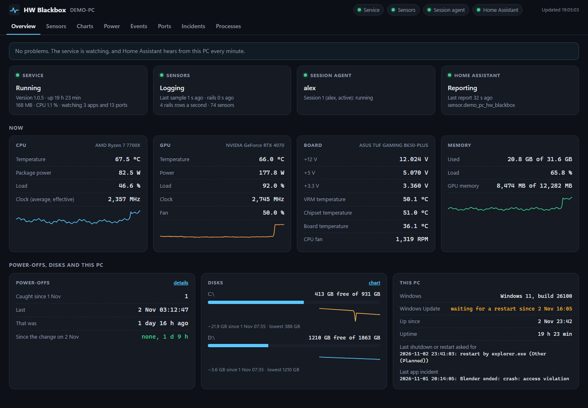
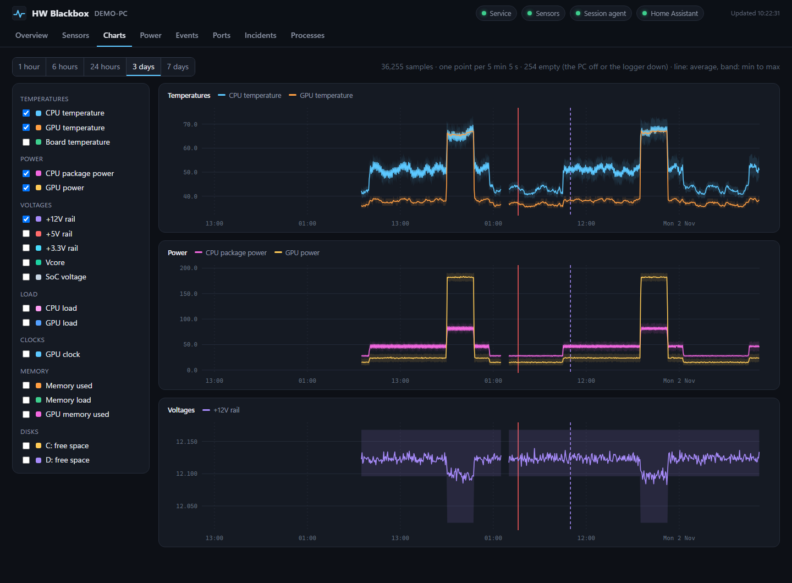
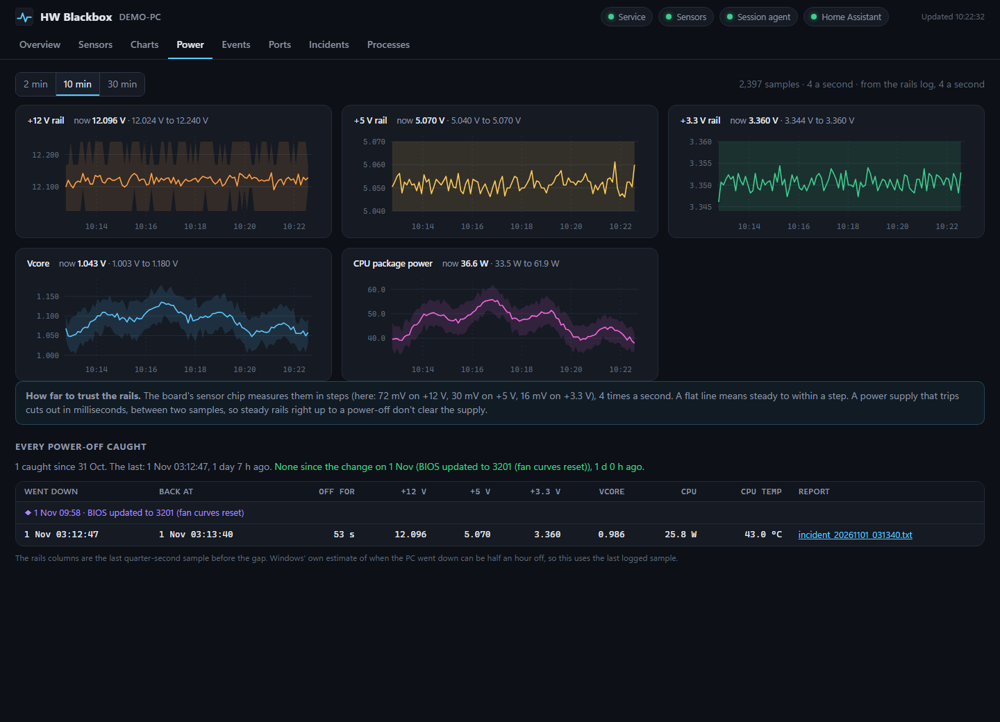
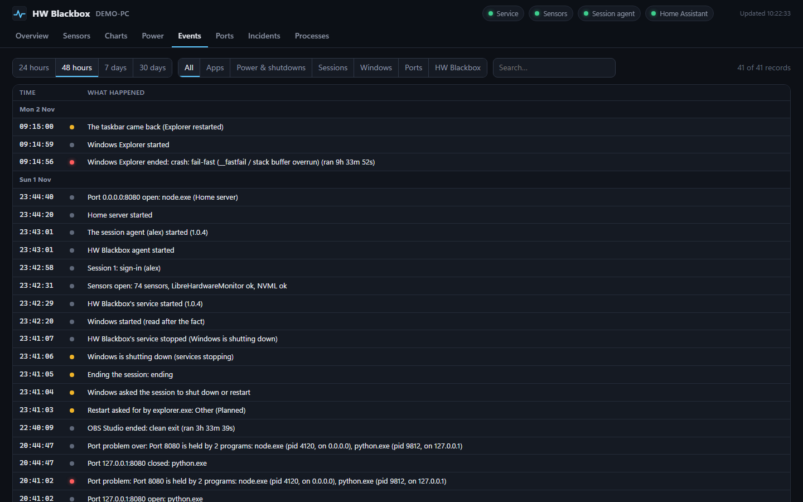
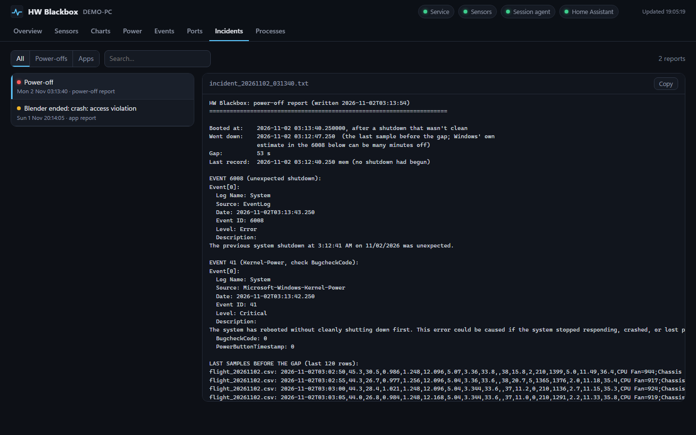

# HW Blackbox

[](https://github.com/jamesccupps/HW-Blackbox/actions/workflows/tests.yml)
[](https://github.com/jamesccupps/HW-Blackbox/releases/latest)
[](LICENSE)

A hardware monitor and a black box for a Windows PC. It answers the question Windows leaves open: *why did the PC
switch off, or why did that app close?*

**[⬇ Download for Windows](https://github.com/jamesccupps/HW-Blackbox/releases/latest/download/HWBlackbox-win64.zip)**
(64-bit Windows 10 or 11; its SHA-256 is in the release's `SHA256SUMS.txt`) · [All releases](https://github.com/jamesccupps/HW-Blackbox/releases) ·
[Website](https://jamesccupps.github.io/HW-Blackbox/)


*The screenshots show made-up data (`tools\make_demo.py`).*

- **Records the moment it happens.** Every sensor every 5 s, and the voltage rails four times a second, written to
  disk before the next reading, so the last seconds before a power loss survive.
- **Writes the report for you.** After a power-off: when the PC really went down (not Windows' guess), for how long,
  and the last two minutes of readings. After an app crash: the exit code in words, and the last three minutes of
  everything.
- **Tells you what's wrong, and what to do.** The Diagnose tab checks what it has recorded (power-offs, crashes,
  the hardware's own error reports, the drives' health, heat, the rails, a program stuck busy or growing without end,
  memory, a laptop's battery, disk space) and says what to do about each.
- **Tells you when it happens.** A Windows notification for a power-off, a crash, a hardware or drive error, or
  something that stopped working, so you hear of it without opening the page.
- **Runs from boot, as a Windows service,** whether or not anyone signs in. Windows restarts it if it ever fails.
- **Stays on your PC.** A local dashboard on `127.0.0.1`. If you run Home Assistant, an optional add-on sends it a
  status, for alerts on your phone or a PC that has gone quiet.

## Install

1. Download **[HWBlackbox-win64.zip](https://github.com/jamesccupps/HW-Blackbox/releases/latest/download/HWBlackbox-win64.zip)**
   and unzip it.
2. Double-click **`Setup.exe`**. Windows asks for an administrator, naming the publisher, **James Cupps**; then it
   installs the service and the agent, and shows what it did as it goes.
   - If the PawnIO driver isn't installed (the CPU and motherboard sensors need it), it asks whether to install it,
     with winget. Press **Y** (or Enter) to install it, or **N** to go on without it.
3. Open **HW Blackbox** from the Start menu, or go to `http://127.0.0.1:9070/`.

Each release lists the zip's SHA-256 (`Get-FileHash .\HWBlackbox-win64.zip`). From 1.1.1 the release is built on
GitHub and signed by James Cupps: Setup.exe, the installer script, and a catalog of every file, which the installer
checks every file against. More options are under [Install, in detail](#install-in-detail).

## A closer look

| | |
|---|---|
|  **Charts:** any reading over days, with power-offs (red) and your own milestones |  **Power:** the rails four times a second, and every power-off caught |
|  **Events:** crashes, shutdowns and who asked, sessions, port clashes |  **Incidents:** the report written after a power-off |

## What it records

- **Sensors.** Every sensor LibreHardwareMonitor finds is read every 5 s: CPU, motherboard sensor chip, fan
  controllers and Corsair digital power supplies. An NVIDIA GPU is read through NVML, an AMD or Intel GPU through
  LibreHardwareMonitor, and Windows supplies the CPU load and memory.
  - The key readings go to `flight_YYYYMMDD.csv`.
  - The +12 / +5 / +3.3 V rails, Vcore and SoC go to `rails_YYYYMMDD.csv`, four times a second, with the CPU's power
    and temperature (read once a second).
  - Every row is written to disk before the next one is taken (fsync), so the last rows before a sudden power loss
    survive.
- **Power-offs.** At the boot after a shutdown that wasn't clean (Windows' Kernel-Power 41 and EventLog 6008), it
  writes a report with:
  - the time the PC really went down: the last logged row, which can be half an hour off Windows' own guess;
  - how long it was off;
  - the last two minutes of both logs, the rails trace last;
  - whether the service had seen a shutdown begin;
  - how Windows says it went off (a blue screen and its stop code, by name; the power button held; sleep), and the
    hardware's own error reports around it.
- **Shutdowns.** Who asked for a shutdown or restart (User32 1074). Windows asking each session to end, with the
  idle time and the app in front. The service's own goodbye as services stop, so a missing goodbye means the power
  went.
- **Apps.** The apps on a watch list, in every session: when they start and end, the exit code and what it means
  (clean, crash, killed by another program), and their memory every minute. A crash gets an incident report with the
  last 3 minutes of everything and the app that was in front.
- **Windows' records.** Crashes, hangs and error reports for any app (named by the program its exe belongs to: a
  `python.exe` can be anyone's), display driver resets, low memory, services ending unexpectedly, boots and
  shutdowns. Records written while the service wasn't running are read at its next start.
- **Hardware errors.** The errors the CPU, the memory and PCI Express report to Windows (WHEA), corrected or fatal.
  A corrected one did no harm, but keeps happening on a part or a setting on the edge (an overclock, XMP / EXPO, a
  riser cable); a fatal one is a blue screen. And the drives' own: bad blocks, retries, a controller reset, a damaged
  file system.
- **Drives.** Once an hour, each drive's health as Windows judges it, its temperature, its wear, and the errors it
  has counted (Windows' storage counters, as `Get-StorageReliabilityCounter` shows them).
- **Ports.** Who listens on which TCP port, every 15 s. It flags two programs on one port where their addresses
  overlap (one on all addresses and one on 127.0.0.1, say), a known port held by the wrong program, and a server
  that should always be listening but isn't.
- **Sessions.** Sign-ins, locks and sign-outs; sleep and resume; screen changes (resolution, position, scaling); the
  taskbar coming back after Explorer restarts; the clock being changed.
- **Programs.** Every program's CPU, memory, graphics memory and GPU use, minute by minute, all its processes
  together, plus the time the processors spent on drivers' interrupts. Windows keeps no such history: Task Manager
  only shows now. So when the CPU was busy at 3 in the morning, or a program grew by gigabytes overnight, the
  Processes tab says which program it was. The GPU's figures come from Windows' own GPU counters (the ones Task
  Manager uses), so they work for any make of GPU.
- **Disk space.** Every fixed drive's free space, once a minute, to chart over days. The Windows drive is a problem
  when it gets low or fills up fast (an update unpacking, a download, a runaway log). It also notes a Windows update
  that's waiting for a restart.

**Notifications:** each signed-in user gets Windows notifications for what's new: a power-off, an app's crash
report, a hardware or drive error, a problem that lasts a minute. Each kind can be turned off on the page's Settings
tab. They're rationed (one of a kind every 10 minutes, six an hour), and nothing from before the install is announced.

**Home Assistant** is an optional add-on: a status every minute, so your automations can alert you (see
[Home Assistant](#home-assistant)).

## How it's built

| Part | Runs as | Does |
|---|---|---|
| **Service** `HWBlackbox` | LocalSystem, from boot, whether or not anyone signs in | sensors, power-offs, apps, Windows' records, hardware errors, the drives, ports, status, Home Assistant (if it's set up) |
| **Session agent** (task `HWBlackboxAgent`) | each signed-in user, not elevated | what only a session can see: the screens, the app in front, the taskbar, sign-outs; serves the dashboard; shows that user's notifications |
| **Dashboard** | a page in your browser, from the agent, on `127.0.0.1` | everything above |

What keeps it reliable:

- **The service is a real Windows service.** Windows restarts it if it fails. It also hears about shutdowns,
  sessions, sleep and clock changes directly, and gets time to write a last record when Windows shuts down.
- **A dead man's switch** ends the service if any part of it stops moving (a stuck driver call, a deadlock), so
  Windows starts it again. It's a native thread-pool timer, so it still works when Python itself is wedged.
- **The rails lane has its own high-priority thread** and keeps to a schedule. A slow GPU read can't hold it up, and
  Windows' 15.6 ms timer rounding doesn't make it drift.
- **The CPU has a lane of its own.** Reading the CPU's sensors means visiting each core in turn, and a core kept busy
  by a program of higher priority can hold that up for seconds. So the CPU is read once a second on its own thread,
  and the rails never wait for it.
- **The service starts the agent again** through its scheduled task if the agent stops in a signed-in session.
- **Ports come from Windows' own listener table.** That's `GetExtendedTcpTable` with `TCP_TABLE_OWNER_PID_LISTENER`,
  not the connection table's state field, which is garbage on some Windows builds (netstat and
  `Get-NetTCPConnection` list the wrong ports there).
- **Every process in one call** (`NtQuerySystemInformation`), about 10 ms, rather than seconds of asking process by
  process. It brings every process's CPU time and memory with it.
- **Windows' GPU counters once a minute**, on a thread of their own (`GPU Process Memory` and `GPU Engine`, through
  PDH): NVIDIA's own interface can't tell programs' graphics memory apart on Windows.

## Requirements

- **Windows 10 or 11, 64-bit, and an administrator account** to install.
- **PawnIO** for the CPU and motherboard sensors (temperatures, voltages, fans). It's the signed driver
  LibreHardwareMonitor uses for low-level hardware access (freeware, by namazso), installed separately: `Setup.exe`
  offers to install it with winget when it's missing, or `winget install namazso.PawnIO`. Without it you still get the
  GPU, the CPU load, memory and everything that isn't a sensor; the page says the driver is missing, and Diagnose says
  how to install it.
- **Laptops** work too. A laptop has no power supply rails to read, so the Overview shows its battery instead (charge,
  plugged in or not, the rate it charges or drains, its wear), the 5-second log records the charge and whether it
  was plugged in, and a power-off report says what the battery was at just before.
- **To build:** Python 3.12 (64-bit), and LibreHardwareMonitorLib's DLLs in `lib\` (see [Building](#building)). The
  installed program carries its own Python, so nothing else is needed on the PC.

## Install, in detail

`Setup.exe`, from the unzipped [release](https://github.com/jamesccupps/HW-Blackbox/releases/latest), asks Windows
for an administrator and runs `install.ps1` in its window (a signed Setup.exe runs only an `install.ps1` signed by
the same publisher):
- If the PawnIO driver is missing, it asks whether to install it (with winget, in the installer's window).
- It copies the program into a folder of its own in Program Files (`HWBlackbox.new`) and checks every file against
  the release's manifest, while an installed HW Blackbox keeps running. Only the build's files are copied: anything
  else in the release folder is left out. A signed release's files must also match its catalog, `HWBlackbox.cat`,
  signed by the same publisher as the script. If a file doesn't match, it stops there, with nothing installed
  changed.
  Then it stops the running HW Blackbox and puts the new one in `C:\Program Files\HWBlackbox`.
- It sets up the data folder.
- It registers and starts the service and the agent's task, and adds **HW Blackbox** to the Start menu and to
  **Settings → Apps → Installed apps**, and its name to Windows' notifications.
- It checks that everything reports.

Its log is `%TEMP%\hwblackbox-install.txt`. Running it again updates an installed HW Blackbox and keeps the settings
and the history.

### Uninstall

**Settings → Apps → Installed apps → HW Blackbox → Uninstall** (from 1.0.11), or **`Uninstall.cmd`** (in the unzipped
release, or in `C:\Program Files\HWBlackbox`). Either asks Windows for an admin, then removes the service, the agent's
task, the program, the shortcut and the Installed apps entry, and shows what it did.

The data stays in `C:\ProgramData\HWBlackbox` (logs, reports, settings), so a reinstall carries on where it left off.
To remove it too, delete that folder, or from an elevated PowerShell in the release folder:
`.\install.ps1 -Uninstall -RemoveData`. The PawnIO driver is separate: it has its own Installed apps entry.

### Updates

From 1.0.10 on, HW Blackbox updates itself from the page:
- Once a day the page's program asks GitHub for the latest release. When there's a newer one, the top of the page says
  so, with **What's new** (the release's page) and **Update**. The Overview's Service card says when it last asked,
  with **check now**.
- **Update** asks Windows for an admin, then opens a window that downloads the
  release's zip into `C:\ProgramData\HWBlackbox\update` (where only SYSTEM and admins can write), checks it against
  the SHA-256 GitHub gives for it and the one in the release notes, unpacks it, checks it's the version offered, and
  runs that version's installer. The settings and the history are kept; the download is deleted afterwards. Done,
  the window closes by itself and the page reloads into the new version; with problems, the window stays open to
  show them. If any check fails, nothing is installed.
- Nothing is installed without someone at the PC clicking Update and saying yes to Windows: HW Blackbox runs as
  SYSTEM, and installing new code that way without asking would be a risk.
- From an elevated prompt: `& "C:\Program Files\HWBlackbox\python\python.exe" -m hwblackbox update` (`--dry-run`
  stops before the install).

The same from an elevated PowerShell, with options:

```powershell
.\install.ps1 -Set "dashboard.port=9071","home_assistant.enabled=false"   # settings for a first install
.\install.ps1 -PawnIO yes             # install the PawnIO driver if it's missing, without asking (no: never)
.\install.ps1 -Uninstall              # remove the program, the service, the task and the shortcut; keep the data
.\install.ps1 -Uninstall -RemoveData  # ...and delete the data too
```

## The dashboard

Open **HW Blackbox** from the Start menu, or go to `http://127.0.0.1:9070/`. The page has these tabs:

| Tab | Shows |
|---|---|
| **Overview** | the service and the agents, any problems, hardware errors, the key readings now, power-offs, disks (with their last week) and the drives' health |
| **Diagnose** | checks over what's been recorded, each with what it found and what to do: power-offs, hardware errors, crashes, display driver resets, the drives, CPU and GPU heat, the rails, programs stuck busy or growing, RAM, graphics memory, a laptop's battery (its wear, how fast it drains, how low it ran), disk space, a waiting update, uptime |
| **Sensors** | every sensor: current, minimum, maximum and average, since the page opened or since the service started |
| **Charts** | the 5-second log and the drives' free space over 1 hour to 7 days: the line is the average, the band the minimum and maximum |
| **Power** | the 4-a-second rails over the last minutes, and every power-off caught |
| **Events** | the records: apps closing and crashing, shutdowns and who asked, hardware and drive errors, sessions, ports, Windows' records |
| **Ports** | who listens where, and port problems |
| **Incidents** | the power-off and crash reports |
| **Processes** | what's using the CPU and memory right now, and every program's CPU, memory, graphics memory and GPU use over the last week (pick the programs to chart) |
| **Settings** | your notifications (and a test one), and the add-ons: Home Assistant, set up or turned off from here |

The header shows the page's version. After an update, a page that was already open says so and offers a reload.

The dashboard reads; the only things it changes are your own notification settings, and anything that needs an
admin (an update, Home Assistant) is started in a window of its own after Windows' admin prompt. It listens on
`127.0.0.1` alone and answers only requests addressed that way (and changes only from the page itself), so a web page
can't reach it through DNS rebinding. Charts can be read with the keyboard: Tab to one, then the arrow keys.

## Settings

`C:\ProgramData\HWBlackbox\config.json`. Admins can edit it; everyone can read it. Change it with an editor run as
admin, or from an elevated prompt:

```powershell
& "C:\Program Files\HWBlackbox\python\python.exe" -m hwblackbox set dashboard.port=9071 home_assistant.enabled=true
```

The service reads `ports`, `home_assistant`, `dashboard` (its milestones), `disk_warn_gb` and `disk_drop_gb` again
every minute. The watch list and the sensors' timing take a restart of the service (`Restart-Service HWBlackbox`);
the dashboard's port, or turning it off, takes signing out and in again (the session agent serves it). A setting of
the wrong kind (a word where a number goes) keeps its default, and the Overview says which.

```jsonc
{
  "sensors": {"interval_s": 5, "rails_interval_s": 0.25, "keep_days": 183, "rails_keep_days": 7, "lhm_gpu": "auto"},
  "events": {"keep_days": 183},
  "watch": [
    {"exe": "explorer.exe", "label": "Windows Explorer"},
    {"exe": "node.exe", "label": "My server", "ports": [8080], "incidents": "crash"},
    {"exe": "pythonw.exe", "label": "My script", "match": "myscript.py", "exclude": "--test"}
  ],
  "ports": {
    "expected": {"8080": {"label": "My server", "exe": "node.exe", "always": true}},
    "ignore": [],
    "down_after_min": 5
  },
  "home_assistant": {"enabled": false, "env_file": "C:\\ProgramData\\HWBlackbox\\secrets\\home_assistant.env",
                     "entity": "sensor.my_pc_hw_blackbox", "name": "MY-PC HW Blackbox"},
  "dashboard": {"enabled": true, "port": 9070,
                "milestones": [{"at": "2026-10-08T19:03:00", "text": "BIOS setting changed"}]},
  "disk_warn_gb": 10,
  "disk_drop_gb": 10,
  "updates": {"check": true}
}
```

**`updates.check`**: the page asks GitHub once a day for a newer release (`false`: never; **check now** on the
Service card still asks when clicked).

**`disk_warn_gb`** and **`disk_drop_gb`** are about the Windows drive. It's a problem when less than `disk_warn_gb`
is free, or when it's filling up fast: `disk_drop_gb` gone within an hour, and at that rate under `disk_warn_gb`
within two hours (`0` turns that off). A drive with plenty of room that swings by tens of GB (temporary files
written and deleted all day) isn't flagged. Once on, "filling up fast" stays on for 15 minutes, so a swing doesn't
make it flicker. Other drives are logged and charted, not judged: a data drive that's nearly full is often meant to
be.

**`watch` rules:**
- **`match`** and **`exclude`**: a word the command line must or mustn't have.
- **`ports`**: a server found by the port it listens on. The process of the same program that started it is watched
  too, as its supervisor.
- **`incidents: "crash"`**: write a report only for a crash, for an app you stop and start all day. The default is a
  report for any exit but a clean one.

**`milestones`** are marked on the charts, such as a BIOS change you want to compare before and after. The Power tab
counts the power-offs since the newest one.

**`lhm_gpu`** is LibreHardwareMonitor's GPU support.
- **`"auto"`**: on for AMD and Intel GPUs, and off when there's an NVIDIA GPU, which NVML reads instead.
  LibreHardwareMonitor's own NVIDIA code has crashed its host process in the past.
- **`true`** or **`false`**: force it on or off.

## Home Assistant

An optional add-on, off unless you set it up: on the page, **Settings → Home Assistant → Set up…**. Windows asks for
an admin, then a window asks for Home Assistant's address and a long-lived access token (in Home Assistant: your
profile → Security → Long-lived access tokens), tries them, and only then keeps them: the token in
`C:\ProgramData\HWBlackbox\secrets\home_assistant.env`, which only SYSTEM and admins can read. **Turn off…** there
stops it (and offers to delete the token). The same from an elevated prompt:
`& "C:\Program Files\HWBlackbox\python\python.exe" -m hwblackbox homeassistant` (`--off` to turn it off). Or by
hand: that file with `HA_URL=...` and `HA_TOKEN=...` lines, and `home_assistant.enabled` set to `true`.

Every minute the entity gets state `ok` or `problem`, with these attributes:
- `problems`: a list, in words;
- `sensors`, `rails`, `cpu_temperature`, `watcher`, `session_agent`;
- `last_incident`, `last_shutdown`, `last_power_loss`, `last_power_loss_died_at`;
- `last_hardware_error`, `last_drive_error`, `drives` (from 1.1.0);
- `windows_update`: "waiting for a restart since ..." or "no restart waiting";
- `disk_free_gb`, `logs_gb`, `boot`, `version`.

It only reports changes that matter, so the history stays small. Every report still updates `last_reported`, which a
"gone quiet" alert can use:

```yaml
triggers:
  - trigger: state
    entity_id: sensor.my_pc_hw_blackbox
    to: problem
    for: {minutes: 3}
  - trigger: state
    entity_id: sensor.my_pc_hw_blackbox
    attribute: last_power_loss
  - trigger: template
    value_template: "{{ (now() - states.sensor.my_pc_hw_blackbox.last_reported).total_seconds() > 900 }}"
```

## Files

`C:\ProgramData\HWBlackbox`:

| | |
|---|---|
| `config.json` | the settings |
| `logs\flight_YYYYMMDD.csv` | every 5 s: the key readings (kept 183 days, about 2.5 MB a day) |
| `logs\rails_YYYYMMDD.csv` | 4 a second: rails, Vcore, SoC, CPU power and temperature (kept 7 days, about 24 MB a day) |
| `logs\programs_YYYYMMDD.csv` | every minute: each busy or big program's CPU time, memory, graphics memory and GPU share, a row per program (kept 183 days, about 1.5 MB a day). 1.0.7 wrote `cpu_YYYYMMDD.csv` (the CPU alone); it's still read |
| `logs\disks_YYYYMMDD.csv` | every minute: each fixed drive's free and total GB, a row per drive (kept 183 days, about 100 KB a day for two drives) |
| `logs\drives_YYYYMMDD.csv` | every hour: each drive's health, temperature, wear and error counts (kept 183 days) |
| `logs\*.csv.gz` | the day logs above once they're two days old, packed to about a tenth of the size (from 1.1.0); read as before |
| `logs\events_YYYYMMDD.jsonl` | the service's records, one JSON object a line |
| `state\status.json` | the status, every 30 s |
| `state\sensors.json` | every sensor, with its minimum, maximum and average since the service started |
| `state\ports.json` | who listens where |
| `state\drives.json` | the drives' last look |
| `incidents\incident_*.txt` | `incident_<boot>.txt` for a power-off, `incident_<time>_<app>.txt` for an app |
| `sessions\<SID>\` | each user's own, named by their account's SID (the service makes it at sign-in, for that user alone): `session_YYYYMMDD.jsonl`, `agent.json` (its agent's heartbeat), `front.json` (the app in front over the last 3 minutes, overwritten as it changes), `update.json` (the last update check), `settings.json` (their notifications), `notified.json` (what they've been told). Before 1.1.0 these were named by the user; the service moves them at the next sign-in |
| `update\` | an update's download while it installs (removed after), and `install-report.txt`, the installer's report |
| `crash.log` | anything the service couldn't put anywhere else |

From a prompt:

```powershell
$hwb = "C:\Program Files\HWBlackbox\python\python.exe"
& $hwb -m hwblackbox status                  # the service's status
& $hwb -m hwblackbox once                    # one look at everything, printed
& $hwb -m hwblackbox serve --data-dir D:\copy --port 9080   # the dashboard over a data folder copied from another PC
```

The dashboard can link to a view: `#charts:72:cpu_temp_c,v12_v` (those readings, the last 72 hours),
`#charts:168:disk:C:` (C:'s free space, the last week), `#processes:mem` (memory by program; also `cpu`, `vram`,
`gpu`), `#diagnose`, `#sensors:logger`, `#incidents:<report file>`.

## Limitations

- **Tested on two PCs so far,** both on Windows 11: a desktop (AMD Ryzen 5 5600G on a B550 board, NVIDIA RTX 3060)
  and a laptop (Framework, Intel Core i7-1260P, Intel Iris Xe graphics). Other CPUs, sensor chips and GPUs go through
  LibreHardwareMonitor and should work. Which readings show up, and what they're called, varies by board; the rails
  need a sensor chip that reports them, which laptops don't have.
- **Signed from 1.1.1 only.** Earlier releases aren't code-signed (Windows may show *Windows protected your PC* for
  their `Install.cmd`: **More info**, then **Run anyway**); check their zip's SHA-256 against the release notes. A new
  publisher's signature can still meet a SmartScreen warning for a while, until Windows has seen the file enough.
- **Times before 1.1.0 have no time zone.** Since 1.1.0 every time in the logs and records carries its offset from
  UTC (`2026-11-10T18:23:02-05:00`). Older ones are local time: when daylight saving ended, the repeated hour was
  written twice the same way, and they're read in order to tell the two apart.
- **Windows 10 and 11, 64-bit only.** Ports are TCP only.

## Privacy and security

- **Nothing about the PC leaves it** unless you turn Home Assistant on, and then only the status above goes to your
  own Home Assistant.
- **The update check** asks GitHub's API for the latest release once a day, from the page's program (the session
  agent). GitHub sees the request, from your address, with HW Blackbox's version in it; nothing else is sent. Turn it
  off with `updates.check: false`. An update is never installed by itself: see [Updates](#updates).
- **The app in front is kept for the last 3 minutes only**, as a rolling window. It's copied into a record when
  Windows shuts down or restarts, and into an app's incident report; those are kept (records 183 days, app reports
  the same, power-off reports until you delete them).
- **The program history names programs:** each minute, the busiest and biggest programs by exe name (`chrome.exe`,
  `game.exe`), kept 183 days. It doesn't say which account ran them, or what they had open.
- **On a PC with several accounts,** the service's records (apps, ports, power, Windows' records) are on every
  user's dashboard, with every listening program's command line (password-like values hidden as `***`). What each
  user's own agent records (the app in front, their screens, their notification settings) is in a folder only they,
  admins and the service can read.
- **The program can only be changed by admins:** Program Files, with a Python of its own. The service runs as
  SYSTEM, so nothing it loads can be in a folder a normal account can write. The data folder is the same: it belongs
  to Administrators and users can only read it, except each user's own folder in `sessions\`, which the service
  makes for them (users can't make folders there, so nobody can make another's first). The token in `secrets\` is
  for SYSTEM and admins only. The installer moves aside a data folder anyone else made first, and the service never
  writes through a link.
- **Notifications** are shown by Windows on this PC; nothing is sent anywhere.
- **Watching is reading only:** other processes are opened for their exit code and nothing more. HW Blackbox changes
  no settings and never blocks a shutdown.

## Building

```powershell
py -3.12 -m venv .venv
.venv\Scripts\python.exe -m pip install --require-hashes --only-binary=:all: -r requirements.txt
.venv\Scripts\python.exe tools\fetch_lib.py      # lib\: LibreHardwareMonitorLib and its DLLs, from NuGet, by SHA-256
.venv\Scripts\python.exe tools\build.py --zip    # -> build\HWBlackbox, and dist\HWBlackbox-<version>-win64.zip
```

What `build.py` does:
- It checks the venv's packages are the versions in `requirements.txt`, and that `lib\`'s DLLs are the ones shipped
  (by SHA-256): it stops otherwise.
- It copies the interpreter and its standard library (without tests, tkinter or IDLE), plus the packages the program
  uses (and nothing else installed in the venv), into `build\HWBlackbox\python\`. It prints the Python version, which
  the release notes say.
- A `python312._pth` file fixes the module path to those folders only.
- It compiles everything and checks that the result runs on its own.
- It compiles `Setup.exe` (`tools\setup`) with the C# compiler that comes with Windows (.NET Framework 4's).
- It writes `MANIFEST.json` with every file's SHA-256 for the installer to check.
- `--zip` names the zip by version (`dist\HWBlackbox-<version>-win64.zip`): a build to try.

A release is built on GitHub (`.github/workflows/release.yml`, from a `v*` tag): the same build, then Setup.exe,
`install.ps1` and a catalog of every file signed as James Cupps (`tools\sign_release.ps1`, Azure Artifact Signing
through GitHub's own sign-in: no password or key is kept anywhere), the program run once as shipped, the zip, a
statement of where it came from (`gh attestation verify`), and a draft release with the zip as
`HWBlackbox-win64.zip`, the name the download links and the updater expect.

The tests: `.venv\Scripts\python.exe -m unittest discover -s tests`.

To try changes without installing, run a second instance next to the installed one, with its own data folder:

```powershell
.venv\Scripts\python.exe -m hwblackbox console --test --data-dir C:\temp\hwb --run-for 120
.venv\Scripts\python.exe -m hwblackbox agent --test --data-dir C:\temp\hwb
```

`--test` never sends to Home Assistant and never restarts the real agents. Unelevated it has no CPU or board sensors.

The screenshots come from made-up data:

```powershell
.venv\Scripts\python.exe tools\make_demo.py --out C:\temp\hwb-demo --live 600
.venv\Scripts\python.exe -m hwblackbox serve --data-dir C:\temp\hwb-demo     # http://127.0.0.1:9079/
.venv\Scripts\python.exe tools\screenshots.py
```

## License

MIT; see [LICENSE](LICENSE). The bundled third-party software and its licenses are listed in
[THIRD_PARTY_NOTICES.md](THIRD_PARTY_NOTICES.md).
